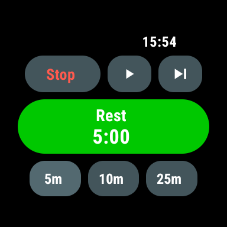
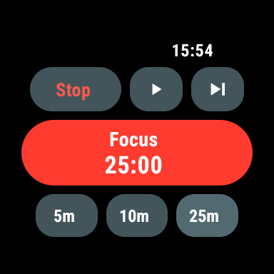
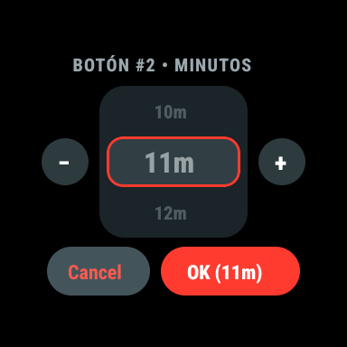

# ChronoWear Pomodoro — Wear OS Smartwatch Timer (React Native + Expo)

Aplicación minimalista de temporizador **Pomodoro (`Rest` / `Focus`)** diseñada específicamente para relojes inteligentes **Wear OS** utilizando **React Native + Expo + TypeScript**.

---

## Capturas en Emulador Oficial de Wear OS 4

| Modo `Rest` (Verde `#00C800`) | Modo `Focus` (Rojo `#FF3B30`) | Wheel / Drum Picker (`1m` – `59m`) |
| :---: | :---: | :---: |
|  |  |  |

---

## Características Principales

- **Interfaz OLED Minimalista para Smartwatch (`#000000`)**:
  - **Reloj superior (`HH:MM`)** alineado en la esquina superior derecha.
  - **Fila 1 — Controles táctiles**:
    - **`Stop`** (texto coral `#FF5A4E` sobre cápsula gris pizarra `#43555B`): detiene el conteo y reinicia al tiempo configurado del modo actual.
    - **`▶` / `II`** (Play / Pausa): inicia o pausa la cuenta regresiva.
    - **`▶|`** (Siguiente modo): alterna entre **`Rest`** y **`Focus`** manteniéndose en pausa (`▶`).
  - **Fila 2 — Cápsula Principal (`Rest` / `Focus`)**:
    - Cápsula gigante tipo estadio en **verde brillante (`#00C800`)** para **`Rest`** y **rojo/naranja (`#FF3B30`)** para **`Focus`**.
    - Tocar la cápsula central también inicia o pausa el temporizador.
  - **Fila 3 — Botones Rápidos Personalizables (`5m`, `10m`, `25m`)**:
    - **Toque corto**: asigna el tiempo al modo actual sin iniciar el conteo automáticamente (solo se da Play al pulsar **`▶`** o la cápsula grande).
    - **Mantener pulsado (Long-Press)**: abre un **Wheel Picker / Drum Picker / Slot Machine Picker** vertical para configurar ese botón entre **`1m` y `59m`**.
- **Memoria Independiente por Modo y Persistencia Local**:
  - Cada modo (**`Rest`** y **`Focus`**) recuerda su propia duración seleccionada al alternar con **`▶|`**.
  - Tanto los presets personalizados como las duraciones de cada modo se guardan automáticamente en el reloj mediante `AsyncStorage`.
- **Feedback Háptico en Muñeca**:
  - Patrón de vibración al finalizar la cuenta regresiva y al interactuar con los controles del reloj.

---

## Descarga e Instalación del APK (Releases)

En la sección [**Releases**](../../releases) encontrarás el APK standalone precompilado (`ChronoWear-Pomodoro-v1.0.0-wearos.apk`) con el bundle de JavaScript integrado (no requiere servidor Metro).

Para instalarlo en un emulador o reloj Wear OS por ADB:

```bash
adb install -r ChronoWear-Pomodoro-v1.0.0-wearos.apk
```

---

## Desarrollo y Ejecución Local

### 1. Instalar dependencias

```bash
npm install
```

### 2. Ejecutar en el Emulador Oficial de Wear OS

1. **Configurar el SDK y AVD de Wear OS (primera vez)**:
   ```bash
   bash ./scripts/setup-wear-sdk.sh
   ```
2. **Iniciar el emulador de Smartwatch (`WearOS_Round`)**:
   ```bash
   npm run wear:emulator
   ```
3. **Compilar el APK standalone, instalarlo y abrirlo en el reloj**:
   ```bash
   npm run wear:run
   ```

### 3. Ejecutar Vista Previa en Navegador Web

Si deseas probar la interfaz en el navegador con un marco de reloj inteligente sin abrir el emulador de Android:

```bash
npm run web
```

---

## Estructura del Proyecto

```text
wearos-pomodoro/
├── App.tsx                                 # Pantalla principal del reloj (Rest/Focus, controles y memoria por modo)
├── src/
│   ├── components/
│   │   ├── WheelMinutePicker.tsx           # Wheel / Drum / Slot Machine Picker (1m a 59m) al mantener pulsado
│   │   ├── Icons.tsx                       # Iconos vectoriales SVG (Play, Pause, Skip)
│   │   └── WebWatchFrame.tsx               # Marco de smartwatch para vista previa web
│   └── theme.ts                            # Paleta de colores OLED para Wear OS
├── scripts/
│   ├── setup-wear-sdk.sh                   # Instala SDK Android + imagen de sistema Wear OS 4 y crea el AVD
│   ├── run-wear-emulator.sh                # Inicia el emulador de reloj inteligente
│   ├── build-and-install-wear.sh           # Compila APK standalone y lo instala vía ADB
│   └── configure-wearos.mjs                # Configura AndroidManifest.xml (android.hardware.type.watch)
└── android/                                # Proyecto nativo Android / Wear OS (Gradle)
```
